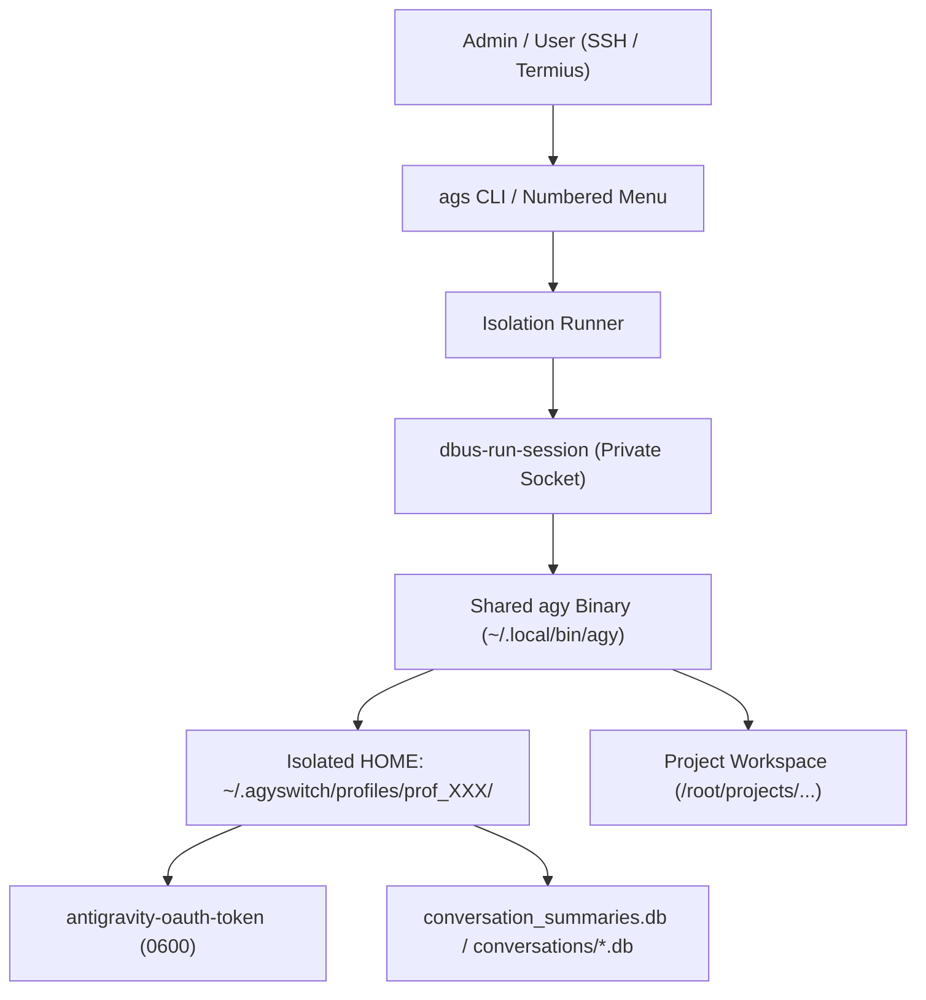

# AGY Switch (ags) — Architecture Specification (v1.0.0)

**Version**: 1.0.0 (MVP Release)  
**Target Platform**: Linux VPS (Ubuntu 22.04 / 24.04 / 26.04+ LTS, Debian 12+, headless SSH, Android Termius / JuiceSSH)

---

## 1. MVP Scope and Design Philosophy

AGY Switch is a lightweight, zero-daemon multi-account profile manager for Google Antigravity CLI (`agy`) on a personal headless Linux VPS.

### 1.1 In Scope (MVP v1.0.0)
- **Arbitrary Named Profiles**: Arbitrary number of Google account profiles without hardcoded limits.
- **Custom Aliases**: User-defined aliases (e.g. `personal`, `test`, `work`, `client-a`).
- **Stable Profile Identifiers**: Internal 12-character hexadecimal IDs (`prof_<hex>`) decoupled from mutable aliases.
- **Zero-Loss Renaming**: Renaming an alias updates metadata only; credentials, session tokens, and conversations remain completely intact.
- **Isolation Boundaries**: Complete isolation of authentication tokens, conversations, brain artifacts, and settings across profiles via dedicated `HOME` directories, `XDG_*` paths, and transient D-Bus sessions.
- **Session Continuity**: Seamlessly resuming conversations via `-c` / `--continue` through direct CLI commands and menu shortcuts (`<num>c`).
- **Dual Interface**:
  - Direct CLI commands (`ags add`, `ags list`, `ags rename`, `ags run`, `ags remove`, `ags version`, `ags update`).
  - Mobile-optimized numbered terminal menu without wide-table wrapping or curses dependencies.
- **Minimal Footprint**: Pure standard Python (Python 3.8+), no external pip dependencies, no Docker requirement, no background daemons, no managed databases.
- **Safe Installation & Updates**: User-local installation via `install.sh`, separating application code from persistent runtime data in `~/.agyswitch`.

### 1.2 Explicit Non-Goals
- **Conversation Migration**: Moving conversations between different Google accounts is strictly out of scope.
- **Automatic Quota Rotation**: No automated account switching to circumvent provider rate limits or terms of service.
- **Multi-Tenant Public Hosting**: `ags` is designed for a single administrator managing their own accounts on a personal VPS.
- **Web Dashboards / GUI**: All interactions occur via terminal SSH.

---

## 2. Directory Structure and System Architecture

### 2.1 File System Layout

Runtime profile data and secrets are isolated in `~/.agyswitch` (configurable via `$AGS_HOME`):

```text
~/.agyswitch/                      # Mode 0700 (owner only)
├── registry.json                 # JSON metadata only (mode 0600)
└── profiles/                     # Dedicated per-profile directories (mode 0700)
    ├── prof_3d78c6fdebf6/        # Stable Internal Profile ID
    │   ├── .cache/               # Profile XDG_CACHE_HOME
    │   ├── .config/              # Profile XDG_CONFIG_HOME
    │   ├── .local/share/         # Profile XDG_DATA_HOME
    │   └── .gemini/
    │       └── antigravity-cli/
    │           ├── antigravity-oauth-token   # Isolated Google OAuth token (mode 0600)
    │           ├── settings.json             # Isolated configuration
    │           ├── conversation_summaries.db # Profile-specific conversation index
    │           ├── conversations/            # Profile-specific SQLite DBs
    │           ├── log/                      # Session execution logs
    │           └── brain/                    # Profile-specific artifacts
    └── prof_6af5ac6a4b0d/
        └── ...
```

### 2.2 Executable Placement
```text
~/.local/bin/ags                  # User-local symlink to repo bin/ags (mode 0755)
/usr/local/bin/ags                # Optional system-wide symlink (when installed as root)
~/.local/bin/agy                  # Shared Google Antigravity CLI binary
```

---

## 3. Metadata Registry (`registry.json`)

### 3.1 Security Principles
- The registry stores **metadata only**.
- It is strictly forbidden to store credentials, OAuth refresh tokens, access tokens, API keys, or passwords in `registry.json`.
- File permissions are enforced at `0600`.
- File writes use an atomic temporary-file-and-rename pattern (`tempfile.NamedTemporaryFile` + `os.replace` + `os.fsync`) to prevent corruption during unexpected power cuts or SSH drops.

### 3.2 Schema Definition
```json
{
  "$schema": "http://json-schema.org/draft-07/schema#",
  "version": 1,
  "updated_at": "2026-10-15T22:25:00+00:00",
  "profile_count": 2,
  "profiles": {
    "prof_3d78c6fdebf6": {
      "id": "prof_3d78c6fdebf6",
      "alias": "personal",
      "home_dir": "/root/.agyswitch/profiles/prof_3d78c6fdebf6",
      "linux_user": "ags_prof_3d78c6fdebf6",
      "created_at": "2026-10-15T20:00:00+00:00",
      "last_used_at": "2026-10-15T22:07:00+00:00"
    }
  }
}
```

---

## 4. Isolation Engine & Security Boundaries



### 4.1 Process Isolation
1. **Transient D-Bus Session**:
   Every invocation is wrapped with `dbus-run-session --`. This creates a temporary Unix domain socket bus per process tree, preventing cross-profile D-Bus and Secret Service contamination.
2. **Environment Isolation**:
   The runner sets `HOME`, `XDG_CONFIG_HOME`, `XDG_DATA_HOME`, `XDG_CACHE_HOME`, and `XDG_STATE_HOME` directly to the profile's directory, ensuring all config, cache, and token writes are contained.
3. **Application-State vs. OS-Level Isolation**:
   - In MVP v1.0.0, isolation operates at the **application-state and credential-storage boundary**.
   - It cleanly separates Google OAuth tokens, conversation databases, and application caches between accounts.
   - **Crucial Notice**: When running AGY on a VPS as root, running as root grants the CLI broad access to the VPS. Application-state isolation is **not** an OS-level sandbox against arbitrary code execution.
   - Untrusted workloads, multi-user deployments, or shared hosting environments require Linux containerization (Docker/LXC/cgroups) or OS UID-level sandboxing. Strict Linux UID-per-profile execution (`runuser`/unprivileged daemon) is deferred to a future security-hardening release.

---

## 5. Mobile UX Architecture

### 5.1 Mobile SSH Constraints (Android / Termius)
- Standard smartphone terminal widths in portrait mode are 40 to 70 columns.
- Traditional tabular outputs with 120+ columns cause ugly wrap-around fragments.
- Full-screen curses TUIs suffer from cursor drift, slow redraws, and screen flicker on mobile connections.

### 5.2 AGY Switch Mobile Solution
- **Card-Based Narrow Formatting**:
  Profile listings in both `ags menu` and `ags list --compact` render as vertical cards (<55 columns).
- **Single-Key & Quick-Resume Shortcuts**:
  - `1`, `2`, `3`: Launch profile session.
  - `1c`, `2c`: Instantly launch and resume previous conversation.
  - `c`: Continue conversation (defaults to the most recently used profile).
- **Graceful Interrupts**:
  Ctrl+C and EOF are caught cleanly without tracebacks.
- **Reliable Return Prompt**:
  Upon session completion, the user is prompted `Press Enter to return to menu...`, preventing prompt flooding and maintaining terminal context.

---

## 6. Concurrent Session Safeguards

Antigravity CLI uses SQLite databases (`conversation_summaries.db`, `conversations/*.db`) and presence lockfiles. Running multiple concurrent AGY processes under the same profile can lead to:
- SQLite lock contention (`sqlite3.OperationalError: database is locked`)
- State and conversation summary desynchronization
- Token refresh race conditions

**Safeguard Mechanism**:
`ags run` inspects `/proc` to check for existing processes using the target profile's `HOME`.
- Interactive sessions: alerts the user and asks for explicit confirmation before proceeding.
- Non-interactive scripts: blocks execution with an error unless `-f`, `--force`, or `--allow-concurrent` is provided.

---

## 7. Resilience and Disaster Recovery

1. **Terminal Disconnections**:
   AGY runs directly attached to standard terminal I/O. SSH drops do not corrupt profiles. Using `tmux` is recommended for persistent remote work.
2. **Registry Durability**:
   Atomic writes prevent half-written JSON files.
3. **Backup and Migration**:
   Moving profiles to another VPS requires copying `~/.agyswitch` with mode `0700` and `0600` permissions. Google OAuth tokens remain valid on the destination machine if copied securely.
