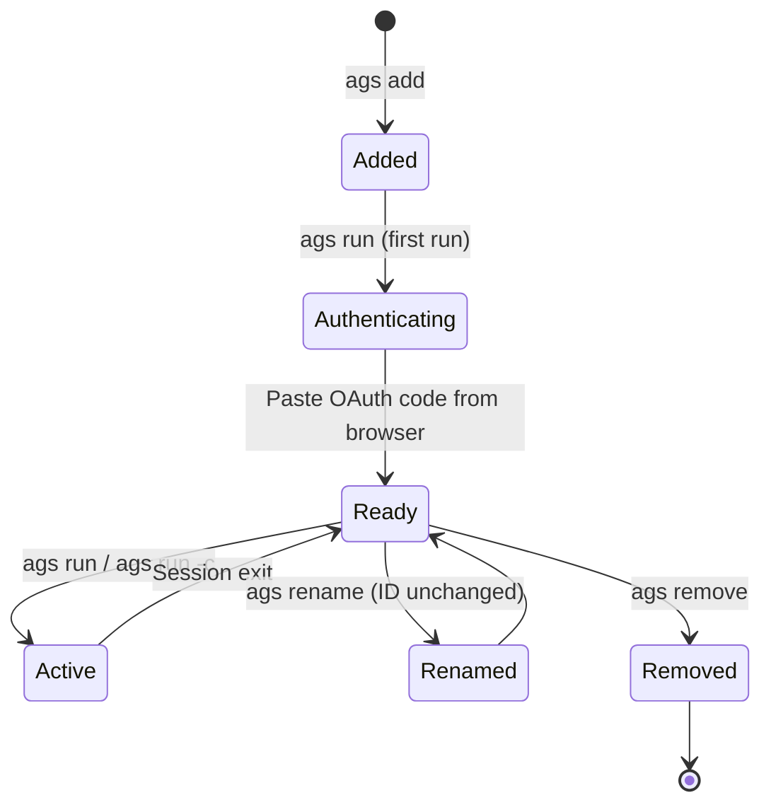
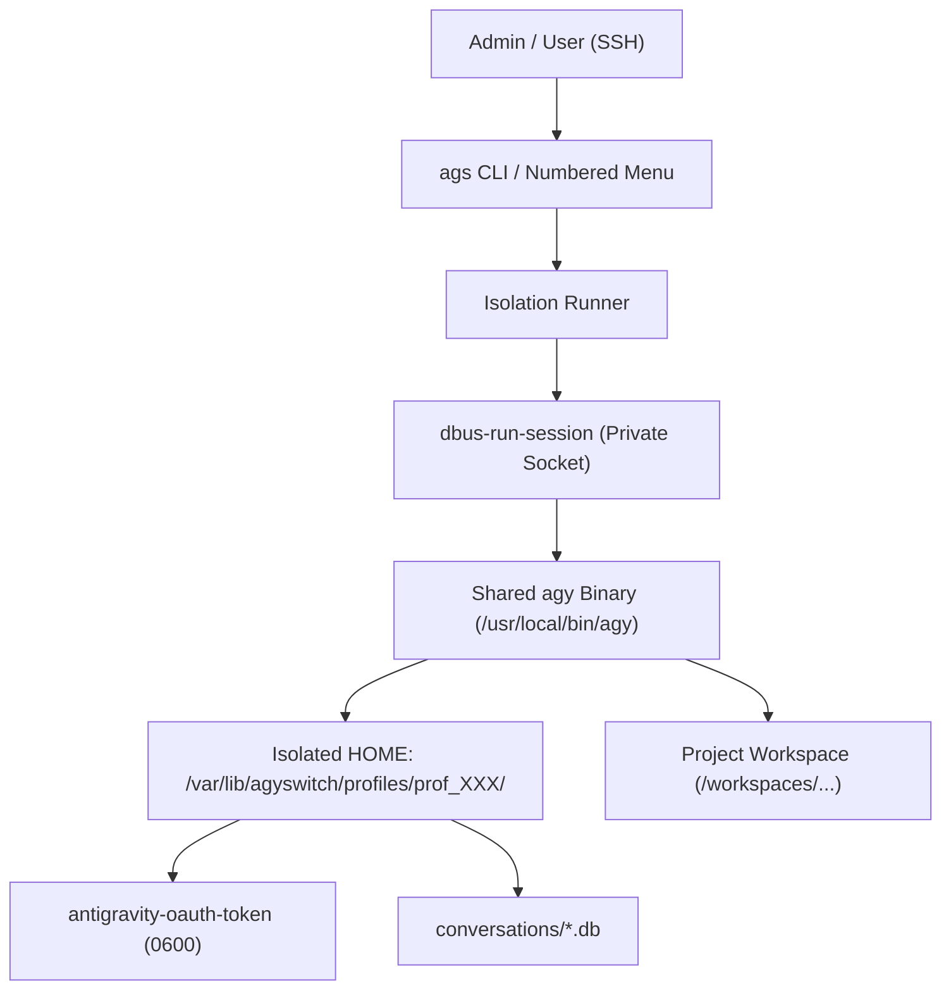

# AGY Switch (ags) — MVP Architecture Documentation

**Version**: 0.1.0-alpha (Phase 00 Architecture Specification)  
**Target Platform**: Linux VPS (Ubuntu 24.04 / 26.04+ LTS, x86_64, headless SSH / Android Termius)

---

## 1. MVP Scope and Non-Goals

### 1.1 In Scope (MVP)
- **Arbitrary Named Profiles**: Unlimited number of Google account profiles without arbitrary ceilings.
- **Custom Aliases**: User-defined aliases (e.g. `personal`, `work`, `client-a`).
- **Stable Profile Identifiers**: Separation of immutable internal profile IDs from mutable user aliases.
- **Zero-Loss Renaming**: Renaming an alias updates metadata only; credentials, session tokens, and conversations remain completely untouched.
- **Isolation Boundaries**: Complete isolation of authentication tokens, conversations, brain artifacts, and settings across profiles.
- **Official Google Sign-In Flow**: Direct headless OAuth device/code flow via AGY CLI.
- **Dual Interface**:
  - Direct CLI commands (`ags add`, `ags list`, `ags rename`, `ags run`, `ags run -c`, `ags remove`).
  - Robust numbered terminal menu (optimized for mobile SSH / Termius virtual keyboards).
- **Lightweight Architecture**: No background daemons, no databases, no web servers. Written in pure standard Python.

### 1.2 Explicit Non-Goals
- **Conversation Migration**: Moving conversations between different Google accounts is strictly out of scope.
- **Automatic Quota Rotation**: No automated account switching to circumvent provider rate limits or terms of service.
- **Multi-Tenant Public Hosting**: `ags` is designed for a single administrator managing their own accounts on a personal VPS.
- **Web Dashboards / GUI**: All interactions occur via terminal SSH.

---

## 2. Directory Structure and System Architecture

### 2.1 File System Layout
```text
/var/lib/agyswitch/
├── registry.json                 # JSON metadata only (mode 0600)
└── profiles/                     # Dedicated per-profile directories (mode 0700)
    ├── prof_376b228f4409/        # Stable Internal Profile ID
    │   └── .gemini/
    │       └── antigravity-cli/
    │           ├── antigravity-oauth-token   # Isolated OAuth token (mode 0600)
    │           ├── settings.json             # Isolated configuration
    │           ├── conversation_summaries.db # Profile-specific conversation index
    │           ├── conversations/            # Profile-specific SQLite DBs
    │           └── brain/                    # Profile-specific artifacts
    └── prof_89a0b1c2d3e4/
        └── .gemini/
            └── antigravity-cli/...
```

### 2.2 Global Executable Placement
```text
/usr/local/bin/agy                # Shared root-owned AGY binary (mode 0755)
/usr/local/bin/ags                # AGY Switch wrapper entrypoint (mode 0755)
```

---

## 3. Metadata Registry (`registry.json`)

### 3.1 Security Principles
- The registry stores **metadata only**.
- It is strictly forbidden to store credentials, OAuth refresh tokens, access tokens, API keys, or passwords in `registry.json`.
- File permissions are enforced at `0600` owned by `root`.
- File writes use an atomic temporary-file-and-rename pattern to prevent corruption during unexpected disconnections.

### 3.2 Schema Definition
```json
{
  "$schema": "http://json-schema.org/draft-07/schema#",
  "version": 1,
  "updated_at": "2026-10-15T20:03:11.234567+00:00",
  "profile_count": 2,
  "profiles": {
    "prof_376b228f4409": {
      "id": "prof_376b228f4409",
      "alias": "personal",
      "home_dir": "/var/lib/agyswitch/profiles/prof_376b228f4409",
      "linux_user": "ags_prof_376b228f4409",
      "created_at": "2026-10-15T20:00:00+00:00",
      "last_used_at": "2026-10-15T20:05:00+00:00"
    },
    "prof_89a0b1c2d3e4": {
      "id": "prof_89a0b1c2d3e4",
      "alias": "work",
      "home_dir": "/var/lib/agyswitch/profiles/prof_89a0b1c2d3e4",
      "linux_user": "ags_prof_89a0b1c2d3e4",
      "created_at": "2026-10-15T20:01:00+00:00",
      "last_used_at": null
    }
  }
}
```

---

## 4. Profile Lifecycle & State Transitions



1. **Add**:
   - Generates stable ID (`prof_<12_hex>`).
   - Validates alias uniqueness and naming safety.
   - Creates profile directory with mode `0700`.
   - Records metadata in `registry.json`.
2. **Authenticate**:
   - Spawns AGY with `$HOME` set to the profile's home directory.
   - AGY displays the official Google sign-in URL.
   - User signs in via browser, pastes code back.
   - Token stored locally in `~/.gemini/antigravity-cli/antigravity-oauth-token`.
3. **Run / Continue**:
   - Sets isolated environment and spawns inside isolated D-Bus session.
   - `-c` flag resumes the latest conversation of this profile.
4. **Rename**:
   - Verifies target alias is available and valid.
   - Updates `alias` key in `registry.json`.
   - Profile ID and directory remain identical.
5. **Remove**:
   - Prompts for confirmation (unless `-f` passed).
   - Deletes metadata entry from registry.
   - Purges profile directory (unless `--keep-data` specified).

---

## 5. Alias Validation & Security Rules

All aliases must satisfy:
- **Regex**: `^[a-z0-9][a-z0-9_-]{0,31}$`
- **Length**: 1 to 32 characters.
- **Normalization**: Automatic lowercasing and trimming.
- **Forbidden Characters**: Spaces, slashes, backslashes, colons, null bytes, backticks, dollar signs, shell pipes, semicolons.
- **Reserved Keywords**: `add`, `list`, `ls`, `rename`, `mv`, `remove`, `rm`, `delete`, `run`, `start`, `exec`, `menu`, `help`, `default`, `root`, `system`, `all`, `none`, `config`, `settings`, `status`.

---

## 6. Authentication & Process Isolation



1. **Transient D-Bus Session**:
   Every invocation is wrapped with `dbus-run-session --`. This creates a temporary Unix domain socket bus per process tree, preventing cross-profile D-Bus and Secret Service contamination.
2. **Dedicated System Users (Optional Strict Mode)**:
   When enabled, `runuser -u ags_prof_<id> --` enforces Linux kernel-level UID separation, disallowing file reads, process inspection, or network socket snooping across profiles.

---

## 7. Workspace Permissions

### 7.1 Challenge
If workspaces reside inside `/root` (mode `0700`), unprivileged profile users cannot traverse into the workspace.

### 7.2 Solution Architecture
- **Shared Workspace Root**: `/workspaces/` (or `/home/shared/workspaces/`).
- **Group Assignment**: Group `ags-workspaces` with SGID (`chmod 2775 /workspaces`).
- **Default ACLs**: `setfacl -d -m g:ags-workspaces:rwx /workspaces`.
- **Validation Check**: `check_workspace_traversal()` checks path traversal before launch; if a workspace is inside a restricted path like `/root`, an actionable message instructs the user.

---

## 8. Failure Recovery & Resilience

1. **Terminal Disconnects (SSH Drop)**:
   Because AGY runs with standard I/O in the foreground (or under `tmux`), an SSH disconnect does not corrupt the profile. Reconnecting and running `ags run <alias> -c` immediately resumes the active conversation.
2. **Corrupted Registry**:
   Atomic file writes (`tempfile.NamedTemporaryFile` + `os.replace`) ensure `registry.json` is never half-written. If corrupted by external tools, `ags` fails cleanly with a descriptive diagnostic message rather than crashing unhandled.
3. **Missing Profile Directory**:
   If a profile directory is manually deleted from disk, `ags` recreates the home directory with `0700` upon next access or warns before execution.

---

## 9. CLI Commands & Numbered Menu UX

### 9.1 CLI Command Reference
- `ags add <alias>`: Add a new profile.
- `ags list` (or `ags ls`): List configured profiles, IDs, last used dates.
- `ags rename <old-alias> <new-alias>` (or `ags mv`): Rename alias.
- `ags run <alias>`: Launch interactive AGY session for profile.
- `ags run <alias> -c`: Continue the most recent conversation.
- `ags run <alias> [args...]`: Forward extra flags (e.g. `--model`, `--agent`).
- `ags remove <alias>` (or `ags rm`): Delete profile.
- `ags menu`: Launch interactive numbered menu.

### 9.2 Numbered Menu (Android/Termius Optimized)
Designed specifically for mobile SSH connections with virtual keyboards:
- Clean linear scrolling (no full-screen curses cursor flickers).
- Direct single-number inputs (`1`, `2`, `3` to launch).
- Short single-letter shortcuts (`a` for add, `c` for continue, `m` for rename, `d` for delete, `q` for quit).
